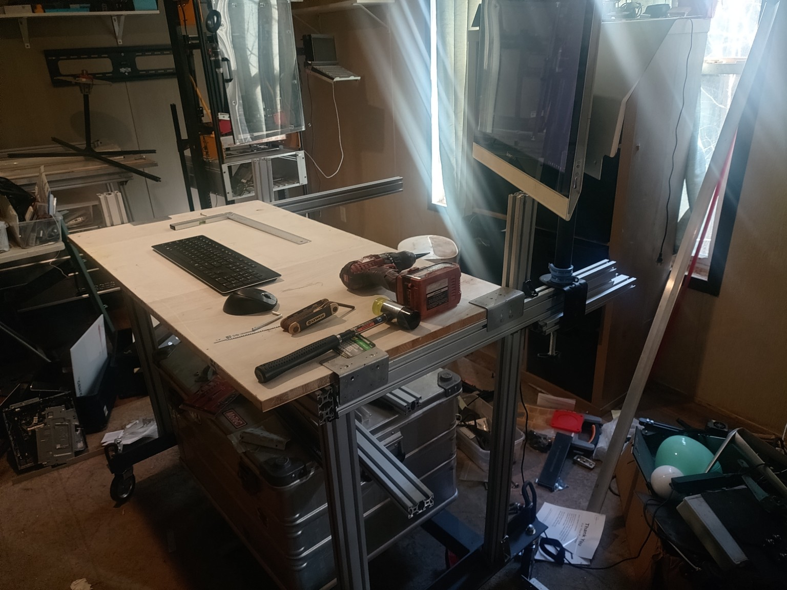

# Cali-Eye Motion Control

Distributed smart motion-control architecture for the Cali-Eye automated inspection/vision gantry.

## Reference architecture: PD-Stepper

Upstream project: **joshr120/PD-Stepper**

https://github.com/joshr120/PD-Stepper

PD-Stepper is being retained as a design/reference source for the Cali-Eye motion system. Preserve upstream attribution and licensing when incorporating upstream material.

### Architecture of interest

- ESP32-S3 local motion controller
- TMC2209 stepper driver
- AS5600 magnetic position feedback
- USB-C / USB-PD power architecture
- Distributed per-axis intelligence
- Local closed-loop position verification rather than relying solely on commanded step counts

## Cali-Eye direction

Cali-Eye should treat each motion axis as a smart actuator/node. A Pi/host controller issues high-level position and scan commands while each node handles local motion, feedback, limits, and telemetry.

Initial target axes:

- X gantry
- Y / sensor positioning
- Z compact linear actuator
- Rotary sensor stage

Candidate Cali-specific additions include CAN or RS-485 networking, home/limit inputs, motor/driver temperature monitoring, current/voltage telemetry, standardized connectors, fault reporting, and integration with the Cali-Eye command/inspection stack.

## Repository strategy

Keep upstream PD-Stepper material identifiable and attributable. Develop Cali-specific hardware/firmware separately so upstream reference material can be compared against the evolving Cali Motion Node design.

## Repository layout

- `reference/PD-Stepper/` — complete upstream snapshot, preserved unchanged
- `hardware/cali-motion-node/` — Cali Motion Node electronics and mechanical integration
- `firmware/` — Cali-specific node firmware and host interfaces
- `docs/` — architecture decisions, interface definitions, and test plans

See `reference/PD-Stepper-UPSTREAM.md` for snapshot provenance and update procedure. PD-Stepper is GPL-3.0 licensed; retain its license and attribution in any derivative work.

## Bench assembly — October 11, 2026

The Cali-Eye bench is assembled and its Lenovo console is operational under Linux Mint XFCE. Motion and vision integration remain pending.

[View all five original bench photographs and the evidence record](docs/evidence/2026-10-11-bench-assembly.md).
